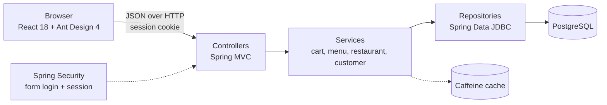
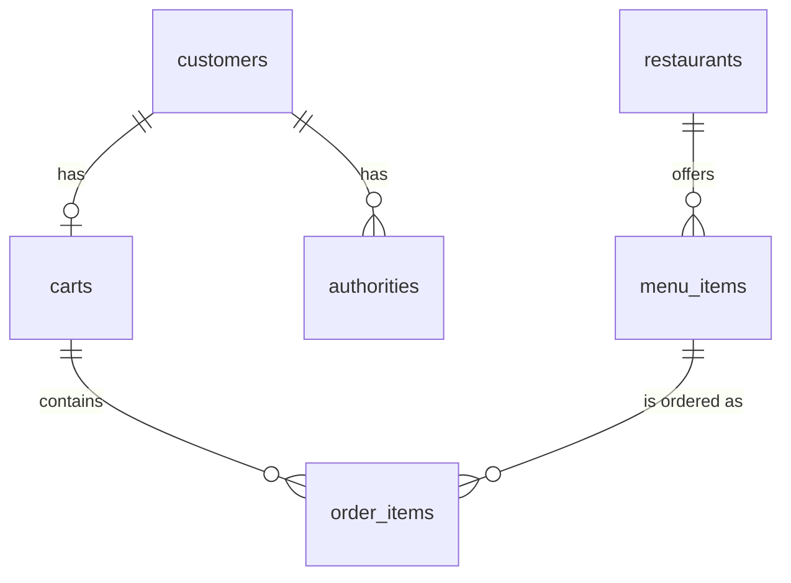

# DeliverFood demo guide

A walkthrough of the DeliverFood online ordering app: what it does, how the pieces fit together, and how to see it working in about five minutes.

## What it does

A customer can register, sign in, browse restaurants and their menus, put dishes in a cart, review the cart with its total price, and check out. Browsing is public; the cart is private to the signed-in user.

## Architecture



| Layer | What it does | Where |
| --- | --- | --- |
| Client | login and sign-up forms, restaurant list, cart drawer; talks to the API with `fetch` | `frontend/src/` |
| Controllers | map URLs to calls, read the request body, return DTOs | `controller/` |
| Services | business logic and transactions; the cart is bound to the signed-in customer | `service/` |
| Repositories | Spring Data JDBC interfaces with a few custom `@Query` methods | `repository/` |
| Security | form login, 401 for anonymous access to protected paths, bcrypt password hashes, users in the database | `AppConfig.java` |
| Cache | restaurants and each customer's cart, 60 seconds, cart evicted on every change | `RestaurantService`, `CartService` |

### Data model



Deleting a customer, restaurant, cart or menu item cascades to the rows that depend on it. `database-init.sql` recreates the schema and loads the seed restaurants and menus at every start.

## Run it

Requirements: JDK 21, Docker, Node.js 20 or later.

```bash
docker compose up -d                 # PostgreSQL on localhost:5432
./gradlew bootRun                    # API on http://localhost:8080
```

In a second terminal:

```bash
cd frontend
npm install
npm start                            # client on http://localhost:3000
```

Or build the client once and let the back end serve it on a single port:

```bash
cd frontend && npm run build && cd ..
./gradlew bootRun --args="--spring.web.resources.static-locations=file:frontend/build/"
```

## Walkthrough

1. **Register.** Click *Register* in the header, fill in email, password and your name, and submit. A message confirms the sign-up and the modal closes.
2. **Sign in.** Enter the email as the username with the password. The header switches from *Register* to *Cart* and the restaurant list appears.
3. **Browse.** Pick a restaurant in the dropdown. Its menu appears as a grid of cards with a picture and a price.
4. **Add dishes.** Click the `+` button on a card. Each button has its own loading state and shows a message when the item is added.
5. **Review the cart.** Click *Cart*. The drawer lists the items and the total price at the bottom.
6. **Check out.** Click *Checkout*. The drawer closes with a confirmation, and opening the cart again shows it empty.

## The same flow with curl

This is what the client does underneath, and it is a quick way to check the API without a browser. The session cookie is kept in `cookies.txt`.

```bash
curl -X POST localhost:8080/signup -H "Content-Type: application/json" \
  -d '{"email": "demo@example.com", "password": "demo-pass", "first_name": "Demo", "last_name": "User"}'
curl -c cookies.txt -X POST localhost:8080/login -d "username=demo@example.com&password=demo-pass"

curl localhost:8080/restaurants/menu                         # public
curl -b cookies.txt -X POST localhost:8080/cart \
  -H "Content-Type: application/json" -d '{"menu_id": 1}'    # add a dish
curl -b cookies.txt localhost:8080/cart                      # items and total_price
curl -b cookies.txt -X POST localhost:8080/cart/checkout     # empties the cart
curl localhost:8080/cart                                     # 401 without the cookie
```

## Things worth pointing out

- **One request path, three layers.** `POST /cart` goes from `CartController` to `CartService` to the repositories. The controller never touches the database, and the service never sees HTTP.
- **The user comes from the session, not from the request.** The cart endpoints take the signed-in `User` from Spring Security, so a client cannot read or change someone else's cart by changing an id.
- **Caching that stays correct.** Reading a cart is cached for 60 seconds, and adding an item or checking out evicts that customer's entry, so the next read is fresh. `CartServiceTests` covers the cart logic with mocked repositories, so those tests need no database.
- **Everything is configurable from the environment.** The database host, port, user and password, and whether the schema is recreated, are environment variables, so the same jar or Docker image runs locally and in the cloud.
- **JSON naming.** Requests and responses use snake_case keys and omit `null` fields, set once in `application.yaml`.

## Known limitations

- Checkout empties the cart; it does not store an order or take payment.
- The signed-in state is held in React state, so reloading the page shows the login form again.
- The login helper puts the credentials in the query string, and the sign-up password box is a plain text input; both are acceptable for local use only.
- A duplicate sign-up and an unknown menu id return generic errors (401 and 500) instead of a clear message.
- The Docker image contains only the API. To serve the client from it, build the client and put the files on the classpath under `static/`.
- The AWS deployment steps in the README are an outline and have not been run.
- Menu pictures are external image links, so they need an internet connection.
